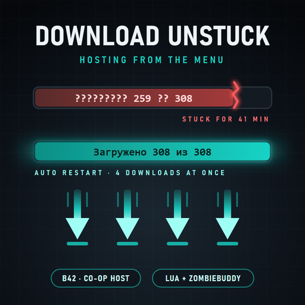

# Download Unstuck

**Un-sticks the "Host" screen of Project Zomboid (Build 42.21+) when the co-op server hangs while downloading Workshop mods.**

> Status: 2.0.2, fixes a server crash of 2.0.0/2.0.1 with ZombieBuddy (see Changes). Tested in a real hosting session (2026-10-29, 308-item modpack hosted from the menu with ZombieBuddy, mods being downloaded and updated): the server reached the world. Steam Workshop: https://steamcommunity.com/sharedfiles/filedetails/?id=3829163351 . If something goes wrong, turn off "Java download loop on the hosted server" in the options and open an issue with `Zomboid/console.txt` and `coop-console.txt`.

When you host a game from the main menu with a big mod list, the server process first downloads every Workshop item into its own folder. With a few hundred mods this takes a long time, and sometimes it simply stops: the status stays on "Downloaded 259 of 308" (in Russian it shows as "????????? 259 ?? 308") forever. The only cure is to press Stop and then Start again; the new server process re-checks the installed items in a few seconds and continues from the stuck one.

Download Unstuck does that for you:
- watches the "Downloaded X of Y" counter; when it stops moving for 40 s (default), it presses Stop and Start itself and the download continues from the same item;
- big items get extra time (1 s per 1.5 MB of the item being downloaded), and every restart on the same item doubles the wait, so a slow but working download is not interrupted forever; after 8 restarts (default) it gives up and names the item it was stuck on;
- also restarts when the freshly started server does not reach the Workshop step within 120 s, or dies in the middle of it (an item that fails three times); once the counter reads "Downloaded N of N" it stands down (the server then makes a backup and sets up UPnP before its next status, which is not a stall);
- shows the status in your language instead of the garbled server text, plus a second line with the name and size of the item being downloaded, the time without progress and the number of restarts;
- an honest progress bar: the Workshop download fills the first half of the bar, the usual loading steps fill the rest.

**Java part (needs [ZombieBuddy](https://steamcommunity.com/sharedfiles/filedetails/?id=3619862853); optional, but recommended for the full experience):** the server you host runs the mod's own copy of the download loop. It downloads one item at a time like the game, because the game's Steam connection refuses a second download while one is running (that is why the parallel downloads of 2.0.0 crashed the server). What it adds: it reports the downloaded bytes and a heartbeat every second, so a slow download of a big mod is not taken for a stall, and a server frozen inside a Steam call (the hang that started this mod) is restarted after 30 s instead of waiting for the counter. The second line then shows what is being downloaded and how many MB arrived. Without ZombieBuddy everything above still works.

Client-side. Enable it in the **main-menu** mod list (Mods) and restart the game once; the server's mod list and the other players are not involved. With ZombieBuddy, it asks once whether to load the new jar; answer Yes. Settings: Options > Mods > Download Unstuck (auto-restart on/off, seconds without progress, maximum restarts, Workshop-step timeout, Java download loop on/off).

Free and open source. The code is written by an AI; the direction, the testing and the time are mine. If the mod made your game better: [support on Boosty](https://boosty.to/lrgpp).

## How it works
**Lua part (the watchdog).** The Host screen (`CoopOptionsScreen.lua`) starts a separate server process and receives its status lines through the `OnCoopServerMessage` event. The server (`GameServerWorkshopItems.Install`) checks the items of the server's `WorkshopItems` list in order and downloads missing or updated ones one at a time, polling Steam every 100 ms with no timeout and no retry. When Steam stalls, nothing ever happens again. The mod wraps the screen's message handler and its Start/Stop buttons: it parses the counter from the status text (the numbers survive the garbling), knows which item is next from the server's list, asks Steam for the titles and sizes through the client, and when the counter is stuck it calls the same `CoopServer:abort()` and `onStartButtonDown()` the buttons use.

**Java part (the download loop).** The Host screen starts the server with `-Djava.class.path=` equal to the client's own class path (`CoopMaster.launchServer`). A ZombieBuddy patch puts `HostUnstuck.jar` in front of that property for the moment the server is started, so the new process loads the mod's copy of `zombie.network.GameServerWorkshopItems` instead of the game's. That copy keeps the game's item query, status lines and reinstall rules, and runs `Downloader` (`src/com/druid/hostunstuck/server`): one `DownloadItem(id, highPriority=true)` at a time like the game, the pending download polled for its state and byte progress. The game's Steam wrapper (`SteamWorkshop.n_DownloadItem` in ZNetJNI) throws "download in progress already" for any request while a download runs, even for the same item, so a stuck download cannot be requested again from inside the process: the loop waits and the host's watchdog restarts the server. A download left over in the process (if the loop is restarted after an exception) is adopted instead of crashing. Settings travel through `Zomboid/Lua/HostUnstuck_server.ini`, written by the client before each launch. The server reports a structured `hostunstuck@...` line every second; the Lua side uses it as "bytes still moving = not stalled" (limit: `stallSeconds` + 20 s), "no line for 30 s = the server is frozen" (restart at once) and for the second status line.

**Safety.** The jar carries the SHA-256 of the game class it replaces (`vanilla.sha256`); after a game update that changes the class, the Java part switches itself off and the game's own loop runs. If the server dies twice in one session during the Workshop step with the Java loop active, the Lua side switches the Java part off for the rest of the session. If the loop throws, the server runs it once more. Nothing in the game's files is modified.

## What it cannot do
It does not make the download faster: the game-server download path has about 4 s of Steam overhead per item and allows one download at a time. A dedicated server is not touched by this mod; admins can get the same loop by starting the server with `-cp HostUnstuck.jar;projectzomboid.jar` (the mod's jar first) and a `HostUnstuck_server.ini` in `<cachedir>/Lua/`.

## Building and testing
`tools/build.sh` (bash; needs JDK 25 and the game) compiles the jar, assembles `dist/HostUnstuck` (the mod folder) and runs three offline tests: `SimTest` (the server loop against a fake Steam that, like the real wrapper, refuses a second download while one runs: a fresh download, an old settings file asking for 4, a download left over in the process, a dead item, updates, failed and refused downloads), `SelfTest` (the game's own JVM started like the Host screen starts the server; checks that the mod's class shadows the game's and that the hash gate passes) and `test/sim_test.py` (the Lua watchdog in lupa, 15 scenarios).

## Changes
- **2.0.2** (2026-10-29): **fixes the server shutting down at "Downloaded 0 of N"** with ZombieBuddy when any mod needed a download or an update. The game's Steam wrapper allows one download at a time and throws on a second request; the parallel loop of 2.0.0 crashed on that, and so did its one-at-a-time fallback. The Java loop now downloads one item at a time like the game and never asks Steam again for an item it still holds (a stuck download is cured by the watchdog's restart). The "Downloads at the same time" setting is gone, the other one is now "Java download loop on the hosted server". Also fixed: the item names on the second line (the server's Workshop list was read before the game loaded the server settings file).
- **2.0.1** (2026-10-29): renamed from Host Unstuck to Download Unstuck (the mod id, jar and settings files stay `HostUnstuck`, so nothing has to be re-enabled); "experimental" removed from the texts. The test that preceded it had nothing to download, so the crash above did not show.
- **2.0.0** (2026-10-29, same build as rc2). **2.0.0-rc2**: ZombieBuddy is really optional now (rc1 listed it under `require=` in `mod.info`, so the game demanded it even for the Lua watchdog; ZombieBuddy itself loads the jar from `javaJarFile` alone). The watchdog no longer counts the server's backup/UPnP after "Downloaded N of N" as a stall. With the Java loop: a server that stops reporting for 30 s is restarted at once (the original hang was the server frozen inside a Steam call, where no re-request can help); bytes are the only progress measure (no size allowance, which with 4 items in flight could delay a restart by minutes); the server's own re-request gets 20 s before a restart; a Steam that leaves normal-priority requests waiting gets them pushed after 8 s and the loop then goes one at a time. Lines from a server process that is being killed are ignored.
- **2.0.0-rc1** (2026-10-28): Java part (a parallel download loop through ZombieBuddy, removed in 2.0.2); 1.0 Lua watchdog.

## Please note
- The code is written by an AI, not by a human.
- It was made only for playing with a friend.
- Tested on one PC, hosting from the main menu.

## My mods
- [SmoothRide MP](https://steamcommunity.com/sharedfiles/filedetails/?id=3827367565) — smooth multiplayer vehicles.
- [ZombieSync MP](https://steamcommunity.com/sharedfiles/filedetails/?id=3827946115) — smooth multiplayer zombies.
- [Tripping Zombies MP Fix](https://steamcommunity.com/sharedfiles/filedetails/?id=3829034899) — the same Tripping Zombies trips for every player.
- [Wandering Hordes Performance Fix](https://steamcommunity.com/sharedfiles/filedetails/?id=3829140377) — no save freezes and no client lag from Wandering Hordes.
- **Download Unstuck** — un-sticks the Workshop download when hosting from the menu (this mod).
- [A-Life: Reactive Survivors](https://steamcommunity.com/sharedfiles/filedetails/?id=3829332775) — A-Life NPCs fight back before the bite (test version).

## License
MIT License — see LICENSE file.

## Author
[druidqwerty](https://github.com/druidqwerty)

For questions or issues, open a GitHub issue.
